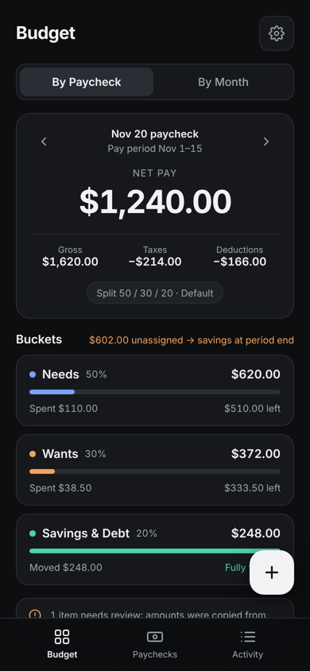
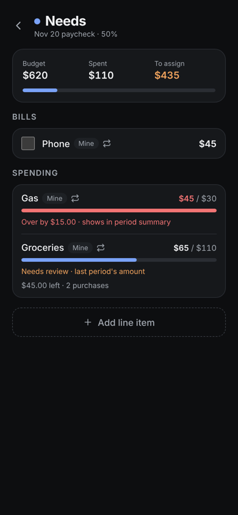
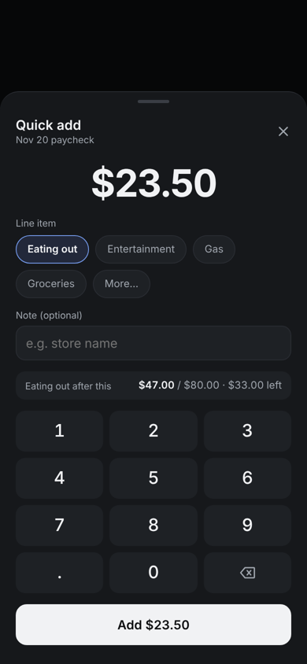

# Budget

An app for my moolah: a free, paycheck-based budgeting app with no subscription and no bank connection. You enter each paycheck, the app splits it 50/30/20 (or your own ratio), and you track bills and spending against that plan.

<p>
  
  
  
</p>

All amounts in the screenshots are sample data.

## Features

- **Paycheck overview:** enter gross pay, taxes, deductions and net pay. You choose which tax and deduction lines appear, and the app flags it when gross − taxes − deductions doesn't match net.
- **Adjustable 50/30/20:** net pay splits into Needs / Wants / Savings & Debt. You can change the ratio for one paycheck or make it your new default, and save presets like "Tight month."
- **By Paycheck or By Month:** budget each check (paid on the 5th and 20th) on its own, or see both checks combined. A check that hasn't arrived yet shows as projected.
- **Recurring line items:** rent, phone, groceries and similar items fill in automatically on each new paycheck. Variable amounts copy last period's number and get a "Needs review" flag.
- **Tags:** each item is Mine, Shared or Logan. For Shared items, only your share counts toward your budget.
- **Tracking:** bills get a checkbox to mark them paid, and the quick-add keypad logs purchases with a live "after this" preview. Planned vs. spent bars turn red when a line goes over.
- **End of period:** leftover Needs and Wants money (unassigned plus unspent, minus any overspending) moves to savings.
- **Backup, export and restore:** a JSON backup file, CSV exports for Excel, and a one-tap restore.
- **Installable:** add it to your iPhone or iPad home screen and it works offline.

## Privacy

There are no accounts and no server. All data is stored in the browser on your device (IndexedDB). Nothing leaves the device unless you export a backup.

## Tech stack

| Piece | Used for |
|---|---|
| [React](https://react.dev) + [Vite](https://vite.dev) | UI and build |
| [React Router](https://reactrouter.com) | Screens |
| [Dexie](https://dexie.org) | On-device database (IndexedDB) |
| [vite-plugin-pwa](https://vite-pwa-org.netlify.app) | Home-screen install + offline |
| [Vitest](https://vitest.dev) | Tests for the budget math and data layer |
| [Netlify](https://www.netlify.com) | Free hosting, deploys automatically on every push |

Money is stored as whole cents to avoid rounding errors. Every record has a unique ID and a `updatedAt` timestamp, so syncing between devices can be added later.

## Project layout

```
src/
├─ lib/         budget math (split, prefill, leftover), money + date helpers, CSV export
├─ db/          database schema and actions (save paycheck, mark paid, backup/restore)
├─ screens/     Home, Bucket, PaycheckForm, QuickAdd, Split, Settings, Setup, …
├─ components/  shared UI pieces and icons
└─ dev/         sample-data seeding (local development only; not in production builds)
```

## Run it locally

```bash
npm install
npm run dev      # http://localhost:5173  (visit /dev/seed for sample data)
npm test         # budget math + database tests
npm run build    # production build in dist/
```

## Roadmap

- **v2:** sync between iPhone and iPad (Firebase), a safe-to-spend number, a payday countdown, savings goals, a period review, an upcoming bills list, and a shared-bills summary
- **Later:** bank CSV import, yearly bills, debt payoff (avalanche/snowball), stats, and a pay forecast from my shift schedule
